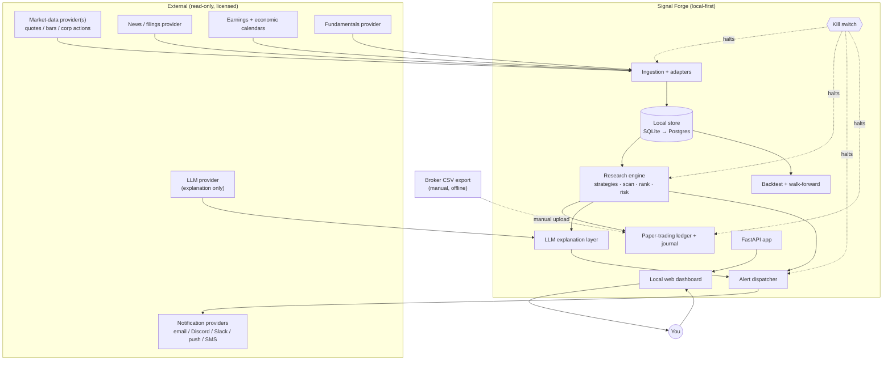

# Signal Forge — Architecture

**Status:** Draft v0.1 (design phase)
**Last updated:** 2026-09-06
**Owner:** Louis Brailey (personal proof of concept)

---

## 0. What this document is

This is the technical design for **Signal Forge**, a local-first, paper-trading-only
market-research and trade-recommendation platform. It defines the system boundaries,
component responsibilities, data model, key interfaces, and the safety/security
invariants that the implementation must never violate.

It is deliberately written before any application code so that the constraints are
fixed first and the build is measured against them.

---

## 1. Objective and non-goals

### 1.1 Objective

1. Continuously ingest properly licensed, accurate U.S. market data.
2. Search a clearly-defined, conservative U.S. instrument universe for
   statistically tested trade candidates.
3. Produce transparent, ranked, evidence-based **long / short / avoid**
   recommendations across holding periods of roughly **1 hour to 6 months**,
   split into four independent horizons.
4. **Paper trade every recommendation by default.**
5. Explain every recommendation, quantify risk, log every decision, and rigorously
   measure whether the system has any **out-of-sample** predictive value.
6. Provide research, simulation, alerting and education only.

### 1.2 Explicit non-goals (V1)

- No brokerage connection of any kind.
- No order execution, no trade routing, no OMS.
- No browser automation of any brokerage or trading venue.
- No scraping of Fidelity or any site that prohibits automated access.
- No unofficial / reverse-engineered brokerage APIs.
- No LLM-driven entry / exit / sizing decisions.
- No machine-learning price prediction.
- No global/OTC/crypto/futures/FX/full-option-chain scanning.
- No profit guarantees, no "high confidence" language without displayed
  out-of-sample + walk-forward evidence.

### 1.3 Product framing shown in the UI

> All recommendations are **hypothetical research outputs**, not financial advice.
> Data may be delayed. You must independently verify every input and make your own
> decisions. Every alert and recommendation carries the line:
> **"Research signal only — no order was placed."**

---

## 2. Safety & security invariants (must-hold)

These are enforced in code, not just documented. Each has an owning module and a test.

| # | Invariant | Enforcement point | Test |
|---|-----------|-------------------|------|
| S1 | No module imports a brokerage SDK, opens a brokerage URL, or stores a field named like a broker credential. | `import-linter` contract + CI grep denylist | `tests/safety/test_no_broker_surface.py` |
| S2 | Account import is **manual CSV only**; importer never makes an outbound network call. | `portfolio.import` package has no network client in its dependency graph | `tests/safety/test_import_offline.py` |
| S3 | No LLM call is on the path that computes direction, entry, stop, target, size, or rank. | `research.*` and `risk.*` packages forbidden (import-linter) from importing `llm.*` | `tests/safety/test_llm_not_in_decision_path.py` |
| S4 | Signals, ranking, risk checks, backtests are deterministic given (inputs, code version, config hash). | Seeded RNG, no wall-clock in pure functions, config hashing | `tests/research/test_determinism.py` |
| S5 | Secrets come only from env / local secrets store; never logged, never in DB, never in git. | `SecretStr` types, log filter, `.gitignore`, pre-commit `detect-secrets` | `tests/safety/test_no_secret_leak.py` |
| S6 | Kill switch immediately halts polling, scheduled jobs, alert dispatch, and paper-trade creation. | Central `KillSwitch` checked in every job entrypoint + API write guard | `tests/safety/test_kill_switch.py` |
| S7 | "Live" label requires a provider capability flag asserting real-time entitlement; otherwise UI shows Delayed/EOD/Historical. | `DataFeedStatus.latency_category` derived from adapter capability, never hard-coded | `tests/data/test_latency_labeling.py` |
| S8 | Stale/unavailable/rate-limited required feed ⇒ live alerts disabled and affected results marked stale. | `FreshnessGate` in scan + alert pipeline | `tests/data/test_freshness_gate.py` |
| S9 | Paper trades are immutable after creation; corrections are separate append-only events. | DB triggers / repository with no `UPDATE`/`DELETE` on `paper_trades` | `tests/paper/test_immutability.py` |
| S10 | No confidence/probability shown unless it is a calibrated out-of-sample number for that exact strategy version. | `Candidate.probability` is `Optional`; renderer hides it without `calibration_ref` | `tests/research/test_probability_gating.py` |

Any change that would weaken S1–S10 must be called out explicitly in the PR description.

---

## 3. System context



Trust boundary: everything inside `SF` runs on your machine. External systems are
**read-only data sources** plus **outbound notifications**. No external system can
instruct Signal Forge (see §12, prompt-injection handling).

---

## 4. Component architecture

```mermaid
flowchart LR
    subgraph adapters["data.adapters"]
      A1["QuoteAdapter"]
      A2["BarAdapter (intraday/daily)"]
      A3["CorporateActionAdapter"]
      A4["EarningsCalendarAdapter"]
      A5["EconomicCalendarAdapter"]
      A6["NewsAdapter"]
      A7["FundamentalsAdapter"]
      A8["ShortInterestAdapter (opt)"]
      A9["OptionsChainAdapter (opt, Phase 3)"]
    end

    adapters --> ingest["data.ingest\nnormalize · dedupe · quality-flag · cache raw"]
    ingest --> repo["data.repository\ntyped read/write, point-in-time reads"]
    repo --> recon["data.reconciliation\ncross-source agreement checks"]

    repo --> features["research.features\nper-horizon feature sets"]
    registry["research.registry\nversioned strategy defs"] --> scan["research.scan\nuniverse walk · quality gates"]
    features --> scan
    scan --> rank["research.rank\nper-horizon ranking"]
    rank --> risk["risk.engine\nposition size · portfolio limits · correlation"]
    risk --> candidates["research.candidates\npersisted Candidate rows"]

    repo --> backtest["backtest.engine\nfills · costs · slippage · sessions"]
    registry --> backtest
    backtest --> wf["backtest.walkforward"]
    backtest --> metrics["backtest.metrics"]
    wf --> health["research.health_monitor\ndowngrade/disable on live underperformance"]

    candidates --> paper["paper.ledger\norders · fills · positions · P&L"]
    candidates --> llm["llm.explain\nnarrative from deterministic facts only"]
    candidates --> alerts["alerts.dispatch\npolicy · quiet hours · dedupe · caps"]
    paper --> journal["paper.journal"]

    subgraph app["app (FastAPI)"]
      httpapi["REST + SSE endpoints"]
      auth["local auth (session cookie)"]
      health_ep["/healthz /readyz /feeds"]
      killapi["kill switch API"]
    end
    candidates --> httpapi
    paper --> httpapi
    backtest --> httpapi

    subgraph jobs["scheduler (APScheduler → Arq in P2)"]
      j1["ingest jobs"]
      j2["scan jobs (per horizon)"]
      j3["daily briefing job"]
      j4["feed health probe"]
      j5["paper mark-to-market"]
    end
    killswitch{{KillSwitch}} -. gate .-> jobs
    killswitch -. gate .-> alerts
    killswitch -. gate .-> paper
```



### 4.1 Package layout (backend)

```
signalforge/
  app/                 FastAPI wiring, routers, auth, templates/SPA host
  config/              typed settings, config-hash, defaults, universe presets
  data/
    adapters/          vendor-specific implementations of the interfaces in base.py
      base.py          Protocol/ABC definitions + capability descriptors
      fixture/         deterministic offline adapter (seed/demo + tests)
      alpaca/ polygon/ tiingo/ ...   (added as configured)
    ingest.py          normalization, dedupe, raw-cache writer
    repository.py      typed persistence + point-in-time reads
    reconciliation.py  cross-source checks, disagreement flags
    quality.py         DataQualityFlag definitions + feed status
  research/
    registry.py        StrategyRegistry, StrategySpec, versioning, status
    features/          feature builders keyed by horizon
    strategies/        baseline strategy implementations (pure functions)
    scan.py            universe walk, exclusion accounting, quality gates
    rank.py            per-horizon ranking
    candidates.py      Candidate assembly + persistence
    health_monitor.py  live-paper vs backtest tracking, auto-downgrade
  risk/
    engine.py          sizing, stop distance, portfolio & correlation limits
    portfolio.py       exposure / concentration math (shared w/ import)
  backtest/
    engine.py          event loop, corporate-action adjustment, sessions
    costs.py           commission, spread, slippage models
    walkforward.py     rolling train/test windows
    metrics.py         win rate, expectancy, profit factor, drawdown, etc.
    montecarlo.py      bootstrap / resampling CIs
  paper/
    ledger.py          orders, simulated fills, positions, P&L
    journal.py         journal entries, rule-adherence scoring
    corrections.py     append-only correction events
  portfolio/
    import_csv.py      OFFLINE manual CSV importer (no network in graph)
    mapping.py         broker-format detection + column mapping
  llm/
    client.py          provider adapter (SecretStr key), token accounting
    explain.py         narrative builder — consumes only deterministic facts
    briefing.py        daily research briefing
    guards.py          output validators (no fabricated numbers, required footer)
  alerts/
    dispatch.py        policy engine (caps, quiet hours, dedupe, staleness)
    channels/          email / discord / slack / push / sms adapters
    templates/         alert bodies (always include the research-only line)
  killswitch.py        single source of truth; checked everywhere
  audit.py             structured decision/event log
  scheduler.py         job definitions + kill-switch gating
  db/                  SQLAlchemy models, Alembic migrations, session
  observability/       structured logging, metrics, request context
  seed/               clearly-labelled simulated demo data
```

### 4.2 Frontend

- **Phase 1 (proposed):** server-rendered Jinja2 + HTMX + Tailwind (CDN in dev,
  built in prod). Charts via lightweight-charts (vendored). One build tool, no
  Node required for the MVP.
- **Phase 2:** migrate to **React + TypeScript + Vite**, Tailwind, an accessible
  component library (Radix/shadcn). REST + SSE contract stays stable across the
  migration, so the backend does not change.

Rationale and tradeoff are in §10.3. This is the one deviation from the requested
stack and is flagged for explicit approval before scaffolding.

---

## 5. Data model (durable store)

SQLite for the MVP, PostgreSQL for durable deployments. SQLAlchemy models +
Alembic migrations from day one so the engine swap is a config change.

### 5.1 Reference & market data

| Table | Purpose | Notable columns |
|---|---|---|
| `instrument` | tradable universe entries | `symbol`, `name`, `type` (etf/stock), `sector`, `industry`, `exchange`, `is_active`, `first_seen`, `delisted_on` |
| `watchlist` / `watchlist_member` | user-defined lists | `name`, `instrument_id`, `added_at` |
| `universe_config` | snapshot of active universe filters | `config_hash`, JSON of thresholds, `effective_from` |
| `ohlcv_daily` | corporate-action-adjusted + raw daily bars | `instrument_id`, `session_date`, `open/high/low/close/volume`, `adj_close`, `split_factor`, `div_cash`, `source`, `ingested_at`, `quality_flags` (bitset/JSON), `is_adjusted` |
| `ohlcv_intraday` | intraday bars (Phase 2) | + `bar_start_ts`, `bar_size`, `session` (pre/rth/post) |
| `quote_snapshot` | last quote used for a scan/candidate | `bid`, `ask`, `mid`, `spread_bps`, `ts`, `source`, `latency_category` |
| `corporate_action` | splits, dividends, symbol changes | `instrument_id`, `type`, `ex_date`, `ratio/amount`, `source` |
| `earnings_event` | earnings calendar | `instrument_id`, `scheduled_for`, `time_of_day`, `confirmed`, `source`, `fetched_at` |
| `economic_event` | macro calendar | `name`, `country`, `scheduled_for`, `importance`, `source` |
| `news_item` | headlines/filings metadata + text ref | `instrument_ids`, `headline`, `published_at`, `source`, `url`, `body_ref`, `sentiment_label` (LLM, optional) |
| `fundamentals_snapshot` | point-in-time fundamentals | `instrument_id`, `as_of`, JSON metrics, `source` |
| `short_interest` | if a licensed source exists | `instrument_id`, `settlement_date`, `shares_short`, `days_to_cover`, `source` |
| `raw_payload_cache` | verbatim provider responses for audit/replay | `provider`, `endpoint`, `request_hash`, `payload` (compressed), `received_at`, `status` |

### 5.2 Data health

| Table | Purpose |
|---|---|
| `data_feed_status` | per (provider, feed_type): `latency_category` (realtime/delayed/eod/historical), `last_success_at`, `last_error`, `rate_limited_until`, `entitlement_note` |
| `data_quality_flag` | typed flags attached to rows or feeds: `missing_values`, `stale_feed`, `split_uncertainty`, `vendor_mismatch`, `rate_limited`, `holiday_or_closed`, `reconciliation_disagreement` |
| `reconciliation_check` | `instrument_id`, `field`, `source_a`, `source_b`, `value_a`, `value_b`, `pct_diff`, `verdict` (`ok`/`flagged`), `checked_at` |

### 5.3 Strategy & research

| Table | Purpose | Notable columns |
|---|---|---|
| `strategy` | logical strategy | `name`, `horizon`, `permits_long`, `permits_short`, `status` (`experimental`/`paper_approved`/`disabled`) |
| `strategy_version` | immutable versioned spec | `strategy_id`, `version`, `git_sha`, `spec_json` (full §6 fields), `created_at` |
| `scan_run` | one scan of one horizon | `horizon`, `started_at`, `finished_at`, `universe_size`, `scanned_count`, `excluded_count`, `exclusions_json` (reason → count + symbols), `no_trade_count`, `config_hash`, `data_snapshot_ref` |
| `candidate` | one evidence-backed candidate | see §7.2 |
| `backtest_run` | one backtest execution | `strategy_version_id`, `params_json`, `date_start`, `date_end`, `is_start`, `is_end`, `oos_start`, `oos_end`, `costs_json`, `config_hash`, `git_sha`, `created_at` |
| `backtest_trade` | simulated trade in a backtest | `run_id`, `instrument_id`, `direction`, `entry_ts`, `entry_px`, `exit_ts`, `exit_px`, `bars_held`, `pnl`, `pnl_r`, `mae`, `mfe`, `costs` |
| `backtest_metric` | metric set per run + per regime segment | `run_id`, `segment` (`all`/`bull`/`bear`/`highvol`/`lowvol`/`range`), JSON metrics, CI bounds |
| `walkforward_window` | one train/test fold | `run_id`, `train_start/end`, `test_start/end`, JSON test metrics |
| `strategy_health` | live-paper vs expectation tracking | `strategy_version_id`, `window`, `paper_expectancy`, `bt_expectancy`, `z_score`, `action` (`none`/`downgrade`/`disable`), `evaluated_at` |

### 5.4 Paper trading, journal, portfolio import

| Table | Purpose |
|---|---|
| `paper_account` | `name`, `initial_cash`, `cash`, `created_at` |
| `paper_order` | `candidate_id`, `account_id`, `side`, `qty`, `order_type`, `submitted_at`, `assumptions_json` (spread, slippage model, ref quote) |
| `paper_fill` | `order_id`, `price`, `qty`, `spread_cost`, `slippage`, `commission`, `filled_at` |
| `paper_position` | `account_id`, `instrument_id`, `qty`, `avg_price`, `strategy_version_id`, `opened_at`, `closed_at`, `realized_pnl` |
| `paper_trade` | **immutable** audit record (append-only): full signal snapshot, plan (entry/exit/stop/time-stop), decision (`accepted`/`rejected`/`ignored`/`watch`), created_at |
| `trade_correction` | append-only correction events referencing a `paper_trade` |
| `journal_entry` | timestamp, `paper_trade_id?`, `candidate_id?`, why-qualified, why-might-fail, plan, notes, outcome, rule-adherence score, lessons |
| `portfolio_import` | CSV batch: `filename`, `sha256`, `broker_format`, `row_count`, `imported_at` |
| `imported_position` / `imported_transaction` | parsed rows; **analytics only**, never fed to the scanner as tradable |

### 5.5 Alerts, settings, audit

| Table | Purpose |
|---|---|
| `app_setting` | typed key/value for all config in §9 with change history |
| `alert_setting` | channel config refs, caps, quiet hours, enabled flags (default all off) |
| `alert_log` | `type`, `channel`, `dedupe_key`, `payload_json`, `status`, `sent_at`, `suppressed_reason` |
| `kill_switch_event` | `enabled`, `reason`, `actor`, `changed_at` (current state = latest row) |
| `audit_log` | generic append-only decision/event log (`actor`, `action`, `entity`, `before`, `after`, `ts`, `request_id`) |
| `llm_call` | `purpose`, `model`, `prompt_sha`, `input_snapshot_ref`, `output_ref`, `prompt_tokens`, `completion_tokens`, `created_at` — every LLM call is auditable |
| `user` | local auth: `username`, `password_hash` (argon2), `created_at`, `last_login` |

---

## 6. Strategy registry

Every strategy is code (a pure function) **plus** a versioned `StrategySpec` record.
A strategy cannot run in a scan unless its spec is complete and its status is
`experimental` (paper-only, no alerts) or `paper_approved` (alerts allowed).

### 6.1 `StrategySpec` fields (all required)

```
name, version, git_sha
horizon                     # INTRADAY | SHORT_SWING | MEDIUM_SWING | POSITION
rule_definition             # precise prose + parameter table
required_data_sources       # feed types + minimum latency category
feature_definitions         # names, formulas, lookbacks, point-in-time notes
entry_conditions            # boolean expression over features
invalidation_conditions     # what makes the thesis wrong before target
exit_logic                  # target rule
stop_logic                  # initial stop placement
time_stop                   # max bars/days in trade
liquidity_requirements      # min ADDV, max spread bps, min price
event_filters               # earnings/econ exclusion windows
assumed_transaction_costs   # commission model
slippage_model              # model + parameters
permits_long, permits_short
known_failure_modes         # enumerated
test_date_range             # full data span used
in_sample_period
out_of_sample_period
walkforward_result          # ref to walkforward run
status                      # experimental | paper_approved | disabled
```

### 6.2 Horizons — independent, never blended

| Code | Horizon | Bar basis (V1) | Holding period | Alert policy |
|---|---|---|---|---|
| A `INTRADAY` | ~1h to close | intraday (Phase 2) | same session | strict; Phase 2+ only |
| B `SHORT_SWING` | 2–10 trading days | daily | up to 10 sessions | up to 2 high-priority/day |
| C `MEDIUM_SWING` | 2–8 weeks | daily | up to 40 sessions | up to 2 high-priority/day |
| D `POSITION` | 2–6 months | daily/weekly | up to ~126 sessions | briefing only by default |

Each horizon has its own feature set, ranking, backtest, performance report, risk
model, and alert policy. There is no cross-horizon composite score.

### 6.3 Baseline strategies (V1)

1. **Trend continuation + volume confirmation** (B, C) — long/short.
2. **Mean reversion after a statistically unusual move** (B) — long/short,
   z-score of returns vs trailing distribution, regime-gated.
3. **Relative-strength / sector-momentum continuation** (C, D) — long-biased,
   short only when `permits_short` and regime is risk-off.
4. **Volatility-contraction / range breakout** (B, C) — long/short.
5. **Post-earnings drift research module** (C) — **disabled by default** until it
   passes walk-forward + Monte Carlo thresholds.
6. **Market-regime filter** (index trend + volatility + breadth proxy) — not a
   trade generator; a gating input consumed by 1–5.

No ML price prediction in V1.

### 6.4 Quality gates (a candidate must pass all)

- Strategy status ∈ {`experimental` (paper only), `paper_approved` (alerts ok)}.
- Instrument passes liquidity filters (price, ADDV, spread).
- No excluded event inside the horizon window (unless the strategy explicitly
  trades the event and is validated for it).
- Required feeds are fresh (see §8) for the instrument.
- Out-of-sample expectancy of the strategy version is > 0 net of modeled costs,
  with the lower CI bound not deeply negative (threshold in config).
- Reward-to-risk estimate ≥ configured minimum.
- Risk engine (§8) can size the position within all portfolio limits.

Failing any gate produces **"NO TRADE — insufficient evidence or poor
risk/reward"** with the specific failed gate(s) recorded. This is expected to be
the common outcome.

---

## 7. Scan, rank, risk, candidate assembly

### 7.1 Scan accounting

Every `scan_run` records, and the UI shows separately:

- **Universe scanned** — instruments actually evaluated.
- **Universe excluded** — with reason breakdown: liquidity, stale/missing data,
  event window, strategy-disabled, risk-limit-blocked.
- **No valid candidate found** — passed filters but no strategy triggered or all
  triggered candidates failed a quality gate.

### 7.2 `Candidate` record

```
scan_run_id, instrument_id, horizon, strategy_version_id
direction                 # LONG | SHORT | AVOID
entry_zone_low, entry_zone_high   # a zone, never a fake exact price
invalidation_level
target_logic / target_ref_level
time_stop
reward_risk_estimate
probability_calibrated?   # only if calibration_ref present
calibration_ref?
risk_dollars, risk_pct_of_account
liquidity_json            # price, ADDV, spread_bps, est_participation
slippage_assumption_json
event_risk_json           # next earnings, macro events in window
portfolio_context_json    # current correlation, sector concentration if taken
reasons_qualify[]         # which rules/features fired, with values
reasons_fail[]            # enumerated ways this trade can lose
data_freshness_json       # per feed: source, ts, latency_category, age
quality_gate_status       # PASS | NO_TRADE(reasons)
created_at
```

### 7.3 Ranking

Per horizon, candidates are ordered by a transparent, inspectable score built from:
expectancy (OOS, net of costs) × reward/risk × liquidity headroom × regime
alignment, penalized by event proximity and existing correlated exposure. Every
term and its weight is displayed on the candidate detail page. Weights are config,
version-controlled, and never set by an LLM.

### 7.4 Risk engine

- Position size from `per_trade_risk_pct` and stop distance; capped by
  `max_position_concentration`, `max_portfolio_exposure`,
  `max_correlated_exposure` (by sector/theme), and `max_daily_portfolio_risk`.
- Rejects (→ NO TRADE) if limits cannot be honored.
- Same portfolio math powers the CSV-import analytics view (§5.4), so long-term
  holdings and paper positions are assessed consistently but shown separately.

---

## 8. Data adapters & freshness

### 8.1 Adapter interface (`data/adapters/base.py`)

Each adapter implements a narrow `Protocol` and publishes a **capability
descriptor**:

```
AdapterCapability:
  provider_name
  feed_type              # QUOTE | BAR_INTRADAY | BAR_DAILY | CORP_ACTION |
                         # EARNINGS_CAL | ECON_CAL | NEWS | FUNDAMENTALS |
                         # SHORT_INTEREST | OPTIONS_CHAIN
  latency_category       # REALTIME | DELAYED | END_OF_DAY | HISTORICAL
  delay_estimate         # e.g. "15 min" when DELAYED
  entitlement_note       # free text from user/provider ("IEX free tier", etc.)
  supports_point_in_time # bool
  rate_limit             # calls/interval
  coverage               # instrument types covered
```

`latency_category` drives every "live vs delayed" label in the UI. It is never
hard-coded to `REALTIME`; an adapter must assert it, backed by the configured
entitlement.

### 8.2 Ingestion

- Normalize to the internal schema; attach `source`, `ingested_at`.
- Write the verbatim provider response to `raw_payload_cache` for audit/replay.
- Deduplicate; compute `quality_flags`.
- Never call sites that prohibit automated access (documented allowlist per
  provider; scraping is out of scope).

### 8.3 Reconciliation

Where two sources exist for a field (e.g. daily close), `data.reconciliation`
compares them; a material disagreement (config threshold) writes a
`reconciliation_disagreement` flag and **downgrades any candidate** that depends
on that value to NO TRADE or "flagged", rather than presenting false precision.

### 8.4 Freshness gate

Before a scan uses an instrument, and before any alert fires:

- Each required feed's `last_success_at` must be within the horizon's freshness
  budget (config), and not `rate_limited`.
- If not: instrument is marked stale for that horizon, excluded from candidates,
  and **live alerts for that horizon are disabled** until recovery. The UI shows
  the stale banner with the timestamp and provider.

### 8.5 First-run configuration

The default local dev config runs against the **fixture adapter** (deterministic,
offline, clearly labelled "SIMULATED") and/or a free/sandbox/delayed provider if
the user supplies a key. The UI makes the latency limitation obvious at all times.
No feed is labelled "live" in this mode.

---

## 9. Configuration surface

All of the following are settings (typed, versioned, editable in the UI, with a
change log). Defaults ship conservative.

- Tradable universe / watchlist(s)
- Min average daily dollar volume
- Max average bid-ask spread (bps)
- Min price
- Market-cap range
- Include short candidates? (default: off)
- Excluded earnings windows (days before/after)
- Max position concentration (% of account)
- Allowed holding-period horizons
- Max alerts per day (default 2 high-priority + 1 briefing)
- Quiet hours (default: overnight)
- Paper account size
- Per-trade risk % (default conservative, e.g. 0.5%)
- Max daily portfolio risk (%)
- Max portfolio exposure (%)
- Max correlated exposure by sector/theme (%)
- Reconciliation disagreement threshold
- Freshness budgets per horizon
- Data-provider keys (env / local secrets store only)
- Notification channel configs (default: all disabled until setup complete)
- Retention windows + local backup location

`config_hash` (stable hash of the effective research-relevant config) is stored on
every `scan_run` and `backtest_run` for reproducibility.

---

## 10. Technology choices

### 10.1 Backend (as requested)

- Python 3.12, FastAPI, SQLAlchemy 2.x, Alembic.
- Pydantic v2 settings with `SecretStr` for all keys.
- Pytest, Ruff, Black, mypy (strict on `research/`, `risk/`, `backtest/`).
- `import-linter` to enforce the S1/S3 architectural contracts.
- Structured logging (`structlog`), `/healthz` `/readyz` `/feeds` endpoints.

### 10.2 Scheduling / jobs

- **Phase 1:** APScheduler in-process (SQLAlchemy jobstore). Simple, no Redis, no
  separate worker — appropriate for a single-user local app and for a Mac that is
  not always on (missed jobs are detected and a catch-up runs on wake).
- **Phase 2:** move to **Arq** (asyncio, Redis) when intraday polling and
  concurrent ingestion make a dedicated worker worthwhile. Job *definitions* are
  written against a thin `JobRunner` interface now so the swap is mechanical.

### 10.3 Frontend — proposed deviation (needs approval)

| Option | Phase 1 cost | Pros | Cons |
|---|---|---|---|
| **A. Jinja2 + HTMX + Tailwind now, React in Phase 2** (recommended) | Low | No Node toolchain to install for the MVP; fewer moving parts; faster to a working evidence page; backend REST/SSE contract identical either way | Less rich interactivity in P1; a real (but contained, contract-stable) rewrite of the view layer in P2 |
| **B. React + TS + Vite from Phase 1** (as originally specified) | High | Matches the target stack immediately; no view rewrite later | Requires Node/npm setup now (not currently installed on this machine); more surface to get the MVP working; slower to first evidence page |
| **C. API-first, defer UI** | Low | Fastest path to a testable engine | No dashboard in P1, which the spec wants |

**Recommendation: Option A.** The dashboards in Phase 1 (overview, scanner,
candidate detail, briefing, kill switch) are mostly read-views with a few POST
actions — HTMX handles that well. The backend does not change, and Phase 2's React
migration is scoped and low-risk because the REST/SSE contract is frozen now.
If you prefer to match the spec exactly, we take Option B.

### 10.4 Deployment

- **Phase 1:** `uv`-managed virtualenv, one `make dev` command (API + scheduler +
  DB migrate + seed), SQLite file in a local data dir.
- **Phase 2:** Docker Compose (api, worker, postgres, redis), one `make up`.
- **Phase 3:** documented external always-on deployment (single small VM),
  secrets via the host's secret store, TLS via reverse proxy.

---

## 11. LLM layer boundaries

Permitted: summarize a deterministic signal in English; explain terms and risk;
summarize retrieved news/filings/transcripts; daily briefing; identify conflicting
news narratives with linked sources; analyze the journal for behavioral patterns;
generate test-plan / strategy documentation.

Forbidden: invent a recommendation with no deterministic trigger; override risk
limits; claim price certainty; generate unsupported statistics; use future
information in historical summaries; make live-execution decisions.

Enforcement:

- `import-linter` contract: `research.*`, `risk.*`, `backtest.*`, `paper.ledger`
  must not import `llm.*` (invariant S3).
- `llm.explain` receives a **frozen facts dict** (numbers, timestamps, sources,
  rule triggers) and may only render prose around those values. `llm.guards`
  rejects output that introduces numeric tokens not present in the facts dict, or
  that omits the required footer.
- Every AI narrative shows: the deterministic strategies + rule triggers beneath
  it, input timestamps, data sources, known missing/stale data, citations, and
  the line **"AI explanation, not a trading instruction."**
- Every call is recorded in `llm_call` with prompt hash and input snapshot ref.

---

## 12. Security & threat model (summary; full `SECURITY.md` in Phase 1)

- **Secrets:** env vars or a local encrypted secrets store (`APP_ENCRYPTION_KEY`
  from env). `SecretStr` everywhere; a logging filter redacts known key names;
  `.gitignore` + `detect-secrets` pre-commit hook; `.env.example` holds
  placeholders only.
- **Local auth:** single user, argon2 password hash, HttpOnly SameSite=strict
  session cookie, CSRF token on state-changing forms, app bound to `127.0.0.1` by
  default.
- **Prompt injection / untrusted content:** news, filings, and any fetched text
  are **data**. They are never interpreted as instructions. The LLM prompt
  template sandboxes retrieved text in a clearly delimited block with a fixed
  system instruction to treat it as content to summarize only. Adapters fetch only
  from configured provider APIs, never arbitrary URLs from content.
- **No outbound trading surface:** import-linter + CI denylist grep (invariant
  S1). No brokerage hostnames in any allowlist.
- **Data at rest:** SQLite/Postgres file in a user-only-readable data dir; backup
  script writes to a user-specified local path; optional age/gpg encryption of
  backups.
- **Kill switch:** a single `kill_switch_event` state row; `KillSwitch.active()`
  is checked at every job entrypoint, every alert dispatch, and as a FastAPI
  dependency on all state-changing research/paper endpoints. Flipping it on is
  itself audited and takes effect within one job-loop tick (<1s for API paths).
- **Audit:** `audit_log` + `llm_call` + `raw_payload_cache` give a replayable
  record of what data was seen and what decision was produced.

---

## 13. Observability

- Structured JSON logs with a request/job correlation id.
- `/healthz` (process), `/readyz` (DB + migrations), `/feeds` (per-feed status +
  latency category + last success).
- Job metrics: last run, duration, rows ingested, exclusions, candidates,
  NO-TRADE count.
- A visible "system health" card on the Overview page; system-health failures are
  the only notification allowed overnight.

---

## 14. Testing strategy

- **Unit:** pure strategy functions, feature builders, cost/slippage models, risk
  math, metrics — deterministic, table-driven.
- **Safety suite** (`tests/safety/`): invariants S1–S10, each with an explicit
  test named after the invariant.
- **Backtest correctness:** synthetic price series with known answers; look-ahead
  and leakage detectors; corporate-action adjustment cases.
- **Property tests** (Hypothesis) for risk sizing (never exceeds limits) and
  ledger (cash + positions conserve value; immutability).
- **Integration:** fixture adapter → ingest → scan → candidate → paper trade.
- **API:** FastAPI TestClient for every endpoint incl. auth + kill-switch gating.
- **Frontend E2E:** Playwright happy-paths (login, view candidate, paper-accept,
  flip kill switch) — added with whichever frontend option is chosen.
- **CI:** GitHub Actions — Ruff, Black `--check`, mypy, import-linter, pytest with
  coverage, `detect-secrets`, frontend lint/build/E2E.

---

## 15. Open decisions (need input)

1. **Frontend for Phase 1** — Option A (HTMX now / React in P2, recommended) vs
   Option B (React now). §10.3.
2. **Market-data provider** — free/sandbox for now, or a specific provider you
   already pay for (Alpaca / Polygon / Tiingo / other). Determines which real
   adapter ships in Phase 1 alongside the fixture adapter.
3. **Notification channels** for Phase 1 — local-only (log + on-page) vs email
   (SMTP) vs Discord/Slack webhook.
4. **Paper account starting size** and **initial watchlist / ETF universe**
   (a conservative default set is proposed in the Phase 1 plan).
5. **Always-on host** — Mac only (jobs run when awake, with catch-up) vs a Pi /
   VM later. Affects Phase 2/3 only.

---

## 16. Change control

- `ARCHITECTURE.md` is versioned in git. Material changes reference a dated entry
  in `docs/decisions/` (lightweight ADRs).
- Any PR that touches invariants S1–S10 must say so and update the relevant
  safety test.
