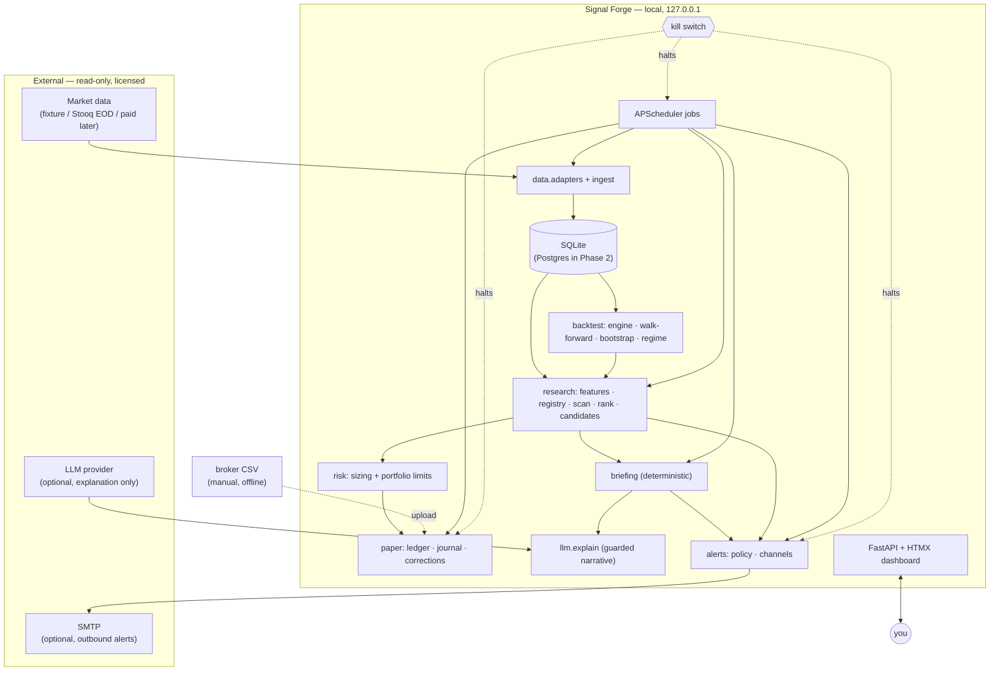
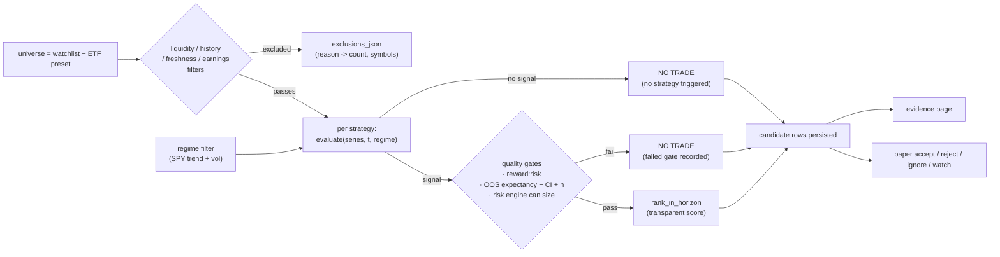
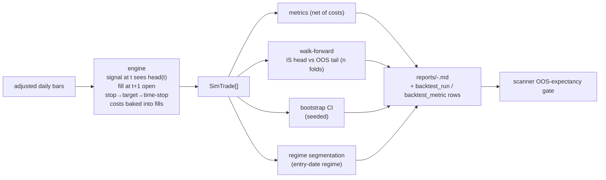

# Signal Forge — architecture diagrams

Companion to `ARCHITECTURE.md`. Rendered on GitHub; run `mmdc` locally if you
want images.

## 1. System context

No path exists from Signal Forge to a brokerage. External systems are data
sources and outbound notifications only.

## 2. The research loop (one horizon)

`NO TRADE` is a first-class, persisted outcome — expected to be the common case.
On the fixture (random-walk) data every candidate is `NO TRADE` because no
strategy has positive out-of-sample expectancy net of costs.

## 3. Backtest → evidence

## 4. Safety controls

```mermaid
flowchart TB
    KS["kill switch\n(file-backed, audited)"] --> J["every scheduled job: guarded() no-ops"]
    KS --> A["alert dispatch: run_alert_cycle raises"]
    KS --> P["accept_candidate / record_decision: raise"]
    KS --> API["state-changing routes: 423 Locked"]

    IL["import-linter contracts"] --> S1["S1 no brokerage / execution / browser automation"]
    IL --> S2["S2 portfolio import has no network in its graph"]
    IL --> S3["S3 research/risk/backtest/paper never import llm"]

    ADP["adapter capability descriptor"] --> S7["S7 'live' only for a REALTIME entitlement"]
    FG["FreshnessGate"] --> S8["S8 stale feed → no live alerts, results marked"]
    TRIG["paper_trade BEFORE UPDATE/DELETE triggers"] --> S9["S9 immutable; corrections are separate rows"]
    DISP["display.probability_display"] --> S10["S10 probability only with a calibration_ref"]
```

